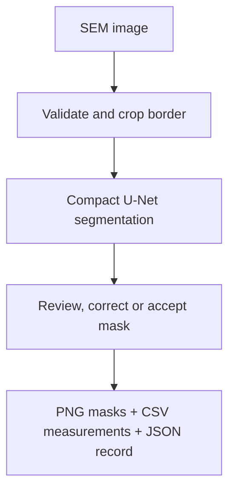

# SEM Review

Project report | Harsh Saand | 22 September 2026

## The problem

A microscope image shows where a defect may be, but a reviewer still needs a mask, a measurement and a record of any correction. SEM Review brings those steps into one local inspection workflow.

## What a user gets

Upload an SEM image, inspect the predicted mask, paint or erase a correction, and export the original prediction alongside the reviewed mask, region measurements and provenance. Measurements describe pixels in the supplied image.

## Practical value

The measured benefit is better agreement with the supplied reference masks than the tested classical method. The practical output is a revisable inspection record. Annotation time saved, production yield and factory defect escapes have not been measured.

## Logic and flow

<strong>Real data and provenance</strong>

- [Carinthia-S, Zenodo record 16895427](https://zenodo.org/records/16895427), published 20 August 2025, **CC BY 4.0**.
- Dataset archive: 139,225,942 bytes; the download script verifies the publisher's MD5 checksum before extraction.
- 4,591 real 480×480 grayscale SEM images with expert-validated segmentation masks.
- Label supports: 1: 55, 2: 8, 3: 4,008, 4: 289, 5: 4, 6: 227. We train binary segmentation only.
- 395 mask files contain gray antialias values. Any nonzero annotation pixel is treated as foreground in both training and native-resolution evaluation.
- Class 6 includes misaligned microscope captures without visible defects. It is **not** a representative clean-wafer control group.
- No wafer/lot identifiers or physical pixel-size calibration are supplied. A pixel area is not a physical area, and an image-level holdout is not a fab-level validation.

See `DATA_ATTRIBUTION.md`, `artifacts/data_audit.json` and the complete public `artifacts/split_manifest.csv`.

<strong>Data separation and model selection</strong>

A fixed 32 px crop removes acquisition borders consistently. Before augmentation, images are checked for identical cropped-pixel SHA256 and potential visual duplicates. The final rule joins pairs only if pHash distance ≤4/63, 128 px thumbnail RMSE ≤2 gray levels, and central 128 px correlation ≥0.995. No exact or qualifying near duplicates were found. Seed 41 five-fold stratified grouping assigns 2,754 images to training, 918 to validation and 919 to test.

The initial diagnostic used a much looser 32 px thumbnail threshold and merged 3,539 visually similar centered-particle images into a component. This was a morphology cluster, not credible evidence of duplicate identity. The tighter rule was chosen from the image audit before final training and any test evaluation. A discarded training run had progressed while UI work continued; its scores did not drive the image-based change. The initial audit is retained for transparency.

The compact U-Net has 275,161 parameters, GroupNorm, and no pretrained weights. It uses BCE plus soft Dice, mild brightness/contrast and rotation/reflection augmentation, and inverse-square-root class-frequency sampling based on training labels. The best checkpoint and one of seven probability thresholds are selected by validation mean Dice. Test masks do not influence model selection.

A classical contrast/morphology baseline uses local Gaussian or global median background subtraction, thresholding, hole filling and minimum region size. Ten fixed parameter choices are compared on validation only. Test evaluation restores both methods to the native cropped 416×416 grid and reports per-image and per-class Dice, IoU, two-pixel-tolerance boundary F1, pixel-area error and absolute coverage error.

<strong>Reading the review flag</strong>

The review score is a simple heuristic based on mean confidence inside the predicted region, with extra flags for an empty, very small or unusually large prediction. It is **not calibrated Bayesian uncertainty or a probability that the inspection is wrong**. `metrics.json` reports empirical error across retained fractions ranked by this score; a favorable trend is not assumed. Every inspection still requires human judgment.

<strong>Measured results</strong>

On **919 held-out images**, the U-Net achieved **0.941 mean Dice / 0.895 IoU**, compared with **0.738 Dice / 0.602 IoU** for the validation-selected classical baseline. Native cropped-grid boundary F1 at a 2-pixel tolerance was 0.778 versus 0.274. Mean absolute area error was417 pixels versus 2,247 pixels. The model has 275,161 parameters and trained for 12 epochs on Apple MPS.

Warmed CPU forward inference took 22.3 ms median across 30 runs with 4 threads; this excludes preprocessing, file I/O and browser/network time. Per-class supports are 11, 2, 802, 58, 1 and 45, so these are predominantly majority-class results. All 45 empty test masks remained empty, but these are misaligned captures and do not establish production false-alarm performance.

<strong>Run the trained application</strong>

Use the [repository setup and reproduction instructions](https://github.com/HarshSaand/sem-review/blob/0bd0a3e6254a90b3118868ec562ec9ed91d2f49f/README.md) for the environment, data preparation, command-line options and application launch. The pinned revision keeps those commands aligned with the implementation described here. Saved outputs can be inspected without repeating model training.

<strong>Evidence and limitations</strong>

Machine-readable results are in `artifacts/metrics.json`, with per-image support in `artifacts/test_per_image.csv`. `artifacts/heldout_panels.png` compares held-out inputs, expert masks, U-Net output and the classical baseline. Examples are selected as the median-scoring image in each supported test class plus the lowest-Dice foreground failure; they are not a gallery of only the best cases.

The dataset is heavily imbalanced and comes from one production layer. Centering and electron-framing artifacts can remain shortcuts after border removal. The model may fail on other tools, layers, textures, magnifications and unfamiliar defects. Tiny features can be lost through 192 px resampling. Results describe held-out image segmentation; process/yield improvement and equipment control are outside the project scope.

Own code: MIT. Dataset and included derived example images: CC BY 4.0 with attribution. Trained model weights are research artifacts derived from the cited data.

## Evidence and reproduction references

Source revision: 0bd0a3e6254a90b3118868ec562ec9ed91d2f49f

- [README.md](https://github.com/HarshSaand/sem-review/blob/0bd0a3e6254a90b3118868ec562ec9ed91d2f49f/README.md)
- [artifacts/metrics.json](https://github.com/HarshSaand/sem-review/blob/0bd0a3e6254a90b3118868ec562ec9ed91d2f49f/artifacts/metrics.json)

This report describes the source and saved evidence at the revision above. Training and full benchmark runs were not repeated for this documentation release. Dataset, model and dependency licences remain separate from the project documentation.
